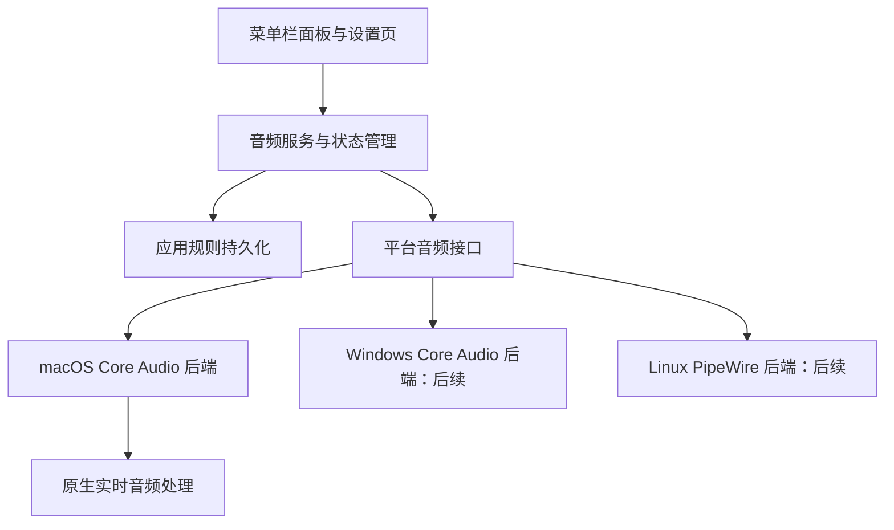

# Mac Voice Mix 产品需求与技术方案

日期：2026-11-09  
状态：产品范围初版，技术栈已更新为 Tauri 跨平台方案；尚未实现或完成音频原型验证  
项目暂定名：Mac Voice Mix（对外产品名称待定）

## 1. 目标与默认假设

实现一个常驻 macOS 菜单栏的音频控制应用，在一个面板中调整输入设备音量、输出设备音量和各应用的输出音量。后续能够扩展到 Windows 和 Linux。

本文将需求中的“各个应用的输出的影响大小”理解为“各应用独立输出音量”。例如，将浏览器降到 30%，音乐播放器保持 100%，会议应用设为 70%，同时通过输出设备音量统一控制最终播放音量。

初版假设如下，后续可以调整：

- macOS 优先，建议最低支持 macOS 14.4；Apple Silicon 为第一验证目标，Intel 支持以实际构建和测试结果为准。
- 首版提供真正的应用独立音量控制，不能仅用系统总音量代替。
- 音频在本机实时处理，默认不保存或上传音频，不要求登录。
- 设备音量和基础应用音量范围均为 0%–100%；超过 100% 的软件增益作为后续功能。
- 优先通过公开系统接口实现。旧系统支持、虚拟音频驱动和高级硬件能力另行评估。
- 当前项目目录为空，没有已有技术栈或代码约束。本文给出推荐方案，未锁定最终实现。

## 2. MacMix 参考范围

本文参考 `ljmng7/MacMix` 的公开 README。该项目介绍了菜单栏系统音量、输入/输出设备切换、输入音量、应用独立音量和应用音量记忆；还提供可选的 200% 应用增益、显示器 DDC/CI 音量，以及 EQ、多设备输出和场景预设等扩展功能。[R1]

MacMix 说明应用混音使用 macOS audio process taps，最低运行要求为 macOS 14.4；应用混音需要系统音频录制权限，而设备控制可以独立使用。[R1]

| 参考能力 | 本项目安排 | 理由 |
| --- | --- | --- |
| 菜单栏入口、输出设备音量 | 首版 | 高频操作 |
| 输入设备音量、设备切换 | 首版 | 满足麦克风和日常切换场景 |
| 应用独立音量、静音、音量记忆 | 首版 | 核心需求 |
| 应用增益至 200% | 第二阶段 | 需要限幅和听感验证 |
| 快捷键、场景预设、开机启动 | 第二阶段 | 提升使用效率 |
| 显示器 DDC/CI 音量 | 第二阶段独立评估 | 需要硬件兼容性验证 |
| 每应用 EQ、输出设备路由、多设备输出 | 后续 | 明显增加音频链路复杂度 |
| AirPods 特殊控制、媒体播放控制 | 后续独立评估 | 不属于当前三类音量需求 |

参考功能与交互，不直接复制品牌、图标或素材。若后续计划复用源代码，应先确认具体文件版本及其许可证；本文不作复用授权或许可证结论。

## 3. 产品范围与行为

### 3.1 输入设备

- 列出系统可识别的输入设备，显示名称、当前默认设备和可用状态。
- 调整所选输入设备的输入增益；支持时提供输入静音。
- 切换系统默认输入设备，并监听系统侧的设备和音量变化。
- 检查设备属性是否存在、是否可写；没有输入增益控制的设备显示明确说明和禁用态。
- 初版不采集麦克风音频、不提供输入电平表或监听。后续如增加这些功能，再申请麦克风权限。

这里的输入音量指系统设备输入增益。仅对本应用采集的声音乘以软件系数，不会自动改变会议软件等其他应用拿到的麦克风信号；这种处理不能替代本需求。

### 3.2 输出设备

- 列出系统可识别的输出设备，显示名称、默认状态、音量和静音能力。
- 调整所选输出设备音量、静音；切换系统默认输出设备。
- 支持查看和调整非默认设备的可写音量，但不主动改变其播放路由。
- 监听系统音量键、系统设置及其他应用引起的变化，保持显示一致。
- 对不暴露可写音量的设备显示“此设备不支持系统音量调节”，保留可用的设备切换操作。

默认输出设备切换与“强制迁移所有应用的现有音频流”是不同能力。应用可能自行选择设备；首版应显示实际跟随结果，不承诺所有第三方应用立即切换。

### 3.3 应用独立音量

- 展示系统报告正在产生音频的应用；显示应用名称、图标、音量和静音状态。
- 按应用聚合多个音频进程或流，避免浏览器辅助进程占满列表。
- 独立调整某个应用的输出音量，其他应用的音量设置保持稳定。
- 0% 输出为零，100% 表示应用控制层不衰减；静音独立保存，取消静音恢复此前音量。
- 对暂时停止播放的应用保留短暂宽限期，减少列表跳动；设置页保留已保存的应用规则。
- 应用重启和本应用重启后恢复设置；没有规则的新应用默认 100%、不静音。
- 不能识别归属时显示可辨识的进程名称，不把多个应用错误合并为一个。
- 对系统不提供可用音频流、独占路径或其他无法处理的播放路径，明确显示不支持状态。

初版按应用控制，不按浏览器标签页控制，也不控制各应用的麦克风输入。应用内音量、应用控制层增益和设备音量共同影响实际听感；百分比不是声压测量值。

### 3.4 首版验收范围

首版必须同时交付输入设备音量、输出设备音量和应用独立音量。设备控制可先作为内部里程碑完成，但不能据此宣布核心需求全部完成。

首版不包含 EQ、录音、虚拟麦克风、自动响度归一化、应用指定不同输出设备或多设备同步播放。

## 4. 界面与交互

菜单栏图标打开紧凑面板，内容分为输出、输入和应用三组。常用音量操作不必进入设置窗口。

```text
Mac Voice Mix                                  设置

输出设备   [MacBook 扬声器 ▾]
音量       ━━━━━━━━━●━━━━━━  70%       [静音]

输入设备   [内置麦克风 ▾]
输入增益   ━━━━━━●━━━━━━━━━  45%       [静音*]

应用
Safari     ━━━●━━━━━━━━━━━━  20%       [静音]
音乐       ━━━━━━━━━━━━━━━● 100%       [静音]
会议应用   ━━━━━━━━━●━━━━━━  70%       [静音]

* 仅在设备支持输入静音时提供。
```

- 设备下拉列表显示所有可用设备；完整设备页支持管理非默认设备音量。
- 滑块旁显示百分比，支持键盘调节；不能操作时展示具体原因。
- 第一次启用应用混音时解释用途并触发系统音频录制授权。
- 用户拒绝授权后，设备控制仍可用，应用区提供授权状态和前往系统设置的入口。
- 设置页包含已保存应用规则、规则重置、诊断信息和音频引擎状态。
- 监听系统侧变化；滑块拖动时合并高频命令，避免大量重建音频资源。
- 混音异常时展示受影响应用及“恢复原始播放”操作；退出应用前先恢复播放再释放资源。

## 5. macOS 技术方案

### 5.1 设备控制：Core Audio HAL

推荐使用 Core Audio 的 AudioObject 属性接口完成设备枚举、能力探测、读写和监听。

| 操作 | 拟采用接口或属性 |
| --- | --- |
| 枚举设备 | `kAudioHardwarePropertyDevices` |
| 默认输入/输出 | `kAudioHardwarePropertyDefaultInputDevice`、`kAudioHardwarePropertyDefaultOutputDevice` |
| 稳定设备标识 | `kAudioDevicePropertyDeviceUID` |
| 音量与静音 | `kAudioDevicePropertyVolumeScalar`、`kAudioDevicePropertyMute` |
| 能力判断 | `AudioObjectHasProperty`、`AudioObjectIsPropertySettable` |
| 获取与更新 | `AudioObjectGetPropertyData`、`AudioObjectSetPropertyData` |
| 系统变化监听 | `AudioObjectAddPropertyListenerBlock` 等属性监听接口 |

以上为实现入口，编码时必须依据 SDK 核实 scope、element、数据类型和设备支持情况。先探测主音量，再评估每声道控制；只能控制声道时，应保留声道平衡并明确组合音量策略。

设备读写后读取系统实际值作为结果。设备不存在、属性只读、写入失败等情况返回明确错误，不通过 UI 虚构成功状态。

HDMI、USB、蓝牙设备各自可能存在不同能力和限制，应逐设备探测。没有系统音量的显示器若支持 DDC/CI，可在后续阶段采用独立后端；不能默认所有外接显示器都可调。[R1]

### 5.2 应用控制：Process Tap 与实时回放

Apple 提供 Core Audio process tap，可以截取一个或一组进程的输出音频，也可以配置静音原始进程输出，并将 tap 接入 aggregate device。[R2]

`AudioHardwareCreateProcessTap` 的 Apple API 可用性标注从 macOS 14.2 开始。[R3] 本项目建议首版支持 macOS 14.4 及以上，这是兼容范围选择，不是 API 的引入版本。是否支持 14.2/14.3，应在后续验证后决定。

应用音量控制的拟定链路如下：


推荐先通过单应用原型验证 tap 与物理输出设备的配合，再决定多应用是分别建立链路还是共用一个回放混音器。不同采样率、声道数和时钟需要格式适配及同步处理，不能假定 tap 数据能够直接写入任意输出设备。

关键实现要求：

1. 从音频进程列表映射到用户可理解的应用，维护应用与多个运行进程的关系。
2. 排除本应用的回放进程和自建音频资源，避免再次捕获自身输出造成回路。
3. 使用适合的 tap 静音行为，验证建立链路前后、停止 IO 后和销毁资源时的原始播放恢复。[R2]
4. 准备好资源后再接管播放；控制队列串行执行启停与重建，避免并发资源销毁。
5. 实时回调不执行文件 IO、同步日志、阻塞锁、UI 操作或不可控内存分配；使用预分配缓冲及原子参数。
6. 滑块只更新目标增益；通过短时间增益渐变减轻突变噪声，无需每次拖动重建 tap。
7. 设备切换、采样率变化、睡眠唤醒和进程重启时重建受影响链路。
8. 正常退出和可处理的错误路径恢复原始播放。对崩溃、强制终止后的系统行为做实测，不能仅依靠退出回调。

首版可只接管存在自定义音量或静音规则的应用；其他应用沿用系统播放路径，从而减少实时处理负担。启用、停用和恢复至 100% 时是否释放链路，要由无重音、无长时间断音的测试结果决定。

### 5.3 音量语义

应用层建议采用简单的线性增益：

```text
gain = percent / 100
outputSample = inputSample × gain
静音时 gain = 0
```

它定义的是本项目的应用控制层。设备层的百分比使用系统提供的标量映射，不假定其与应用增益或实际响度线性对应。

第二阶段若加入 200% 增益，最大线性系数为 2，需要加入并验证限幅、峰值提示和增益渐变。Windows 原生共享音频会话接口的音量范围为 0–1，跨平台不能默认都支持同样的超额增益。[R4]

### 5.4 权限与分发

- 设备属性控制与音频捕获分开初始化；首次打开面板不主动开始捕获。
- `Info.plist` 配置 `NSAudioCaptureUsageDescription`，说明申请系统音频捕获权限是为了实时调整应用音量。[R2]
- Apple 示例说明，首次从含 tap 的 aggregate device 开始录制时会触发系统音频录制授权。[R2]
- 权限拒绝或撤销后停止应用混音并清理资源，保留可用的设备控制。
- 首版暂定开发者签名、公证并通过 DMG 分发；沙盒、权限行为和应用商店分发资格在原型阶段核实。
- 麦克风输入电平、全局快捷键等扩展能力分别评估所需权限，不为尚未实现的功能提前申请。

## 6. 架构与跨平台策略

### 6.1 推荐技术路线

采用 **Tauri 2 + React + TypeScript + Rust + 各平台原生音频后端**，共享界面和业务逻辑，首先交付 macOS。详细设计见 [跨平台技术方案](./tauri-technical-design.md)。原生音频接口、实时处理与桌面行为按平台适配。

| 路线 | 优势 | 成本 | 当前建议 |
| --- | --- | --- | --- |
| SwiftUI 首版，平台后端分离 | macOS 系统集成直接，便于验证 Core Audio | Windows/Linux 需要另外实现 UI 或替换界面层 | 原候选，未采用 |
| Tauri + Web UI + 平台原生后端 | 复用界面和设置逻辑 | 仍需原生桥接；需要定义 IPC、打包与实时线程边界 | 已选择 |
| Qt + C++ + 平台音频后端 | 跨平台桌面框架与原生调用路径统一 | 工具链及 macOS 菜单栏体验需要投入 | 团队偏 C++ 时可选 |

这些是工程取舍，不是已验证的性能结论。用户已确认采用跨平台框架，后续以 Tauri 技术方案为准。

首版共享业务层使用 Rust，macOS 后端推荐 Objective-C++ 封装 Core Audio 并提供 C ABI。实时 DSP 先留在原生后端，出现确切复用需求后再抽出共享核心。

### 6.2 分层



界面层只操作设备、应用、会话和能力模型，不直接持有 `AudioObjectID`、COM 指针或 Linux 节点对象。

平台音频接口建议覆盖：

```text
listDevices() -> Device[]
getDefaultDevice(direction) -> DeviceID?
setDefaultDevice(direction, deviceID) -> Result
setDeviceVolume(deviceID, direction, scalar) -> ActualValue
setDeviceMute(deviceID, direction, muted) -> ActualValue
listAppSessions() -> AppSession[]
setAppVolume(appID, scalar) -> Result
setAppMute(appID, muted) -> Result
getCapabilities(target) -> Capabilities
subscribeEvents(handler) -> Subscription
shutdownAndRestoreAudio() -> Result
```

默认设备设置必须作为独立能力暴露。某个平台无法通过选定公开接口可靠实现时，禁用相关动作；不为了统一接口而隐藏差异。

状态由平台后端确认后发布，包含请求失败与系统回读结果。高频 UI 更新、持久化和实时增益参数使用各自合适的更新频率。

### 6.3 平台后端规划

| 平台 | 设备音量 | 应用音量 | 首要差异与验证点 |
| --- | --- | --- | --- |
| macOS | Core Audio HAL 属性 | Process Tap + 增益处理与回放 | 系统音频授权、应用归属、链路恢复 |
| Windows | `IMMDeviceEnumerator`、`IAudioEndpointVolume` | `IAudioSessionManager2`、`ISimpleAudioVolume` | 一个应用多个会话、共享/独占模式、默认设备切换接口选择 |
| Linux | 优先评估 PipeWire + WirePlumber | 优先评估播放 stream/node 的音量与静音 | 桌面音频栈、权限、应用标识、节点重建与策略管理 |

Windows 的 endpoint 接口覆盖输入和输出设备音量；共享模式下可通过音频会话接口控制会话音量。`ISimpleAudioVolume` 不适用于独占模式流，应用列表应体现这种限制。[R4][R5]

Linux 后端是候选方案，本文未完成其 API 原型验证。需从官方文档核实 stream 音量、默认设备策略、事件订阅和应用身份来源；不要直接把会变化的节点 ID 当持久化键。PulseAudio 兼容接口可作为后续兼容方案，ALSA-only 环境暂不纳入首个 Linux 版本。[R6][R7]

跨平台以能力发现为基础：`canSetVolume`、`canMute`、`canSetDefault`、`canBoost`、`requiresCapturePermission` 等。界面根据能力展示，不假设三个系统行为一致。

## 7. 数据模型与设置恢复

| 模型 | 建议字段 |
| --- | --- |
| Device | 平台、稳定 ID、名称、输入/输出方向、可用状态、能力、系统实际音量与静音 |
| AppIdentity | 平台、稳定应用键、显示名称、图标引用、归属可信程度 |
| AppSession | 运行期会话 ID、应用键、进程集合、活动状态、控制状态、错误 |
| AppVolumeRule | 应用键、目标音量、静音、是否启用、更新时间 |
| EngineState | 权限状态、运行状态、当前输出、受控会话、最后错误 |
| Preferences | 配置版本、UI 设置、规则、可选的设备偏好 |

运行期 ID 和持久化 ID 分开：macOS 设备使用 UID，而非会变化的 `AudioObjectID`；应用优先使用 bundle identifier，必要时补充规范化路径和身份信息。Windows/Linux 应用键在对应平台开发时定义，不能直接沿用 PID。

配置文件写入应用标准配置目录，包含 `schemaVersion`，采用原子写入并合并高频更新。macOS 可在 `Application Support/<产品标识>/` 下保存规则。

启动时先读系统现状，再恢复已保存的应用规则。首版默认不覆盖设备音量或强制切换设备，避免覆盖用户在系统中做出的选择；后续场景预设通过明确操作应用整组设置。

损坏配置可备份后使用默认值启动，并通知用户。日志记录错误码和链路状态，不记录音频内容；导出诊断前提供查看入口。

## 8. 异常处理与稳定性

| 场景 | 预期行为 |
| --- | --- |
| 音量属性不存在或只读 | 禁用对应滑块，说明原因，保留其他可用操作 |
| 系统音频权限拒绝/撤销 | 停止混音并恢复原声，设备控制继续可用 |
| 应用停止播放或退出 | 清理运行期会话，保留应用规则 |
| 应用新增辅助进程 | 更新应用归属和受控进程集合，不重复回放 |
| 输出设备断连 | 监听新的系统默认输出，恢复或重建链路；失败时恢复原声 |
| 用户在系统中调音量 | UI 跟随实际状态，避免反馈循环写入 |
| 睡眠、唤醒或音频服务重启 | 重新枚举对象和权限状态，有限次数重试，不沿用过期 ID |
| 音频资源创建失败 | 返回具体错误，销毁已创建资源，避免留下被静音的应用 |
| 正常退出 | 停止接管、恢复播放、停止 IO、销毁私有资源 |
| 崩溃或强制终止 | 通过故障注入验证系统清理行为，必要时设计独立恢复措施 |

引擎建议具有 `stopped → preparing → running → recovering / failed` 的状态转换。启动、停止、回调注销和资源释放应幂等，并处理恢复中再次切换设备的情况。

正常静音与故障恢复要区分：正常运行时尊重用户静音；混音失效时以恢复系统播放为优先，同时告知用户自定义规则暂未生效。

## 9. 性能目标与验收

以下是开发目标，需通过原型和实测确认，不是现阶段承诺：

- 空闲且没有受控音频链路时，CPU 平均占用目标小于 1%。
- Apple Silicon、48 kHz 双声道、3 个受控应用的基础场景，CPU 平均占用初步目标小于 5%；报告需标注芯片、系统版本和统计口径。
- 在内置或有线输出设备上，应用混音引入的额外延迟初步目标不超过 30 ms；与同设备未启用混音的基线比较，蓝牙传输延迟单独报告。
- 系统设备和音量变化通常在 500 ms 内反映到 UI。
- 连续播放 1 小时无可听断音、重复回放或持续内存增长；睡眠唤醒后可继续使用。

验收场景：

1. 两个应用同时播放，降低其中一个应用音量，另一个应用的音量设置和实测信号保持稳定。
2. 应用设为 0% 后输出为零；静音再取消静音恢复此前音量。
3. 调整输入设备增益后，系统回读值一致，并通过支持该设备的会议或录音应用验证实际输入变化。
4. 输出设备音量写入成功后，UI 与系统回读值一致；不支持设备显示准确的禁用态。
5. 浏览器、音乐播放器和会议应用各完成播放、重启、设置恢复与辅助进程归属测试。
6. 用户拒绝授权仍可调设备音量；撤销授权不会留下持续被抑制的原始播放。
7. 内置扬声器、有线耳机、至少一种 USB 音频设备和蓝牙耳机完成切换与断连测试。
8. 睡眠唤醒、应用退出、输出切换和音频服务恢复不会留下长期静音或重音。
9. 正常退出、强制终止和故障注入分别验证原声恢复与资源清理。

后续代码测试应聚焦应用归属、规则恢复、能力探测、状态转换与资源生命周期。音频权限、设备兼容性、实际信号和延迟必须结合真机测试，不能仅靠模拟数据验收。

## 10. 开发阶段

| 阶段 | 交付物 | 完成条件 |
| --- | --- | --- |
| P0：技术原型 | 单设备控制、单应用 tap/增益/回放、权限和恢复记录 | 可控制单应用且无重复播放；退出、切换和失败恢复已验证 |
| P1：macOS 首版 | 菜单栏 UI、三类音量控制、应用规则、错误提示 | 第 9 节核心验收通过 |
| P2：体验与兼容性 | 快捷键、开机启动、场景预设、可选增益；显示器支持评估 | 各项能力具备测试和明确支持范围 |
| P3：Windows | Windows 音频后端、应用会话聚合与对应 UI | 设备和应用音量核心场景通过 |
| P4：Linux | PipeWire 后端及目标发行版适配 | 支持矩阵、核心控制与恢复场景通过 |

暂不估算固定交付日期。P0 结果会直接影响应用混音方案和工作量；尤其要先验证原声抑制与恢复、多应用链路、浏览器归属以及蓝牙切换。

详细目录以跨平台技术方案为准，建议结构如下，当前只创建文档：

```text
docs/
  product-and-technical-plan.md
  tauri-technical-design.md
src/                     # React / TypeScript 共享界面
src-tauri/               # 桌面集成与 Tauri commands
crates/                  # 共享业务与平台后端
native/macos/            # Core Audio 原生桥接
```

## 11. 待验证与待定事项

- P0 验证：tap 的静音模式、aggregate device 拓扑、输出切换、漂移处理、崩溃恢复和权限撤销行为。
- P0 验证：WebKit/浏览器辅助进程与主应用映射，会议应用及受限播放路径的兼容性。
- P0 验证：macOS 14.4、较新 macOS 版本及目标硬件的差异。
- 后续决策：Windows/Linux 的交付优先级与目标系统版本；UI 已选择 Tauri + React。
- 后续决策：Intel 是否纳入首版支持矩阵、是否需要 200% 增益、是否需要商店分发。
- 后续决策：产品名称、图标、许可证，以及是否复用第三方代码。

这些事项不阻碍按本文开展原型验证。技术方案以官方 API 能力和实测结果为准，不能仅依据参考产品的功能说明判定所有设备和应用均可支持。

## 12. 参考资料

以下为本次调研入口。R1、R2、R3、R4、R5 已读取公开内容；R6、R7 为 Linux 后续验证入口，其具体 API 能力尚未在本项目核实。动态文档和仓库内容可能变化，编码时应再次核对 SDK 与目标版本。

- **R1**：MacMix 项目 README：`https://github.com/ljmng7/MacMix`；本次读取 `main/README.md`，未固定 commit。
- **R2**：Apple，Capturing system audio with Core Audio taps：`https://developer.apple.com/documentation/coreaudio/capturing-system-audio-with-core-audio-taps`。
- **R3**：Apple，AudioHardwareCreateProcessTap：`https://developer.apple.com/documentation/coreaudio/audiohardwarecreateprocesstap(_:_:)`。
- **R4**：Microsoft，ISimpleAudioVolume：`https://learn.microsoft.com/en-us/windows/win32/api/audioclient/nn-audioclient-isimpleaudiovolume`。
- **R5**：Microsoft，IAudioEndpointVolume：`https://learn.microsoft.com/en-us/windows/win32/api/endpointvolume/nn-endpointvolume-iaudioendpointvolume`。
- **R6**：PipeWire 官方文档入口：`https://docs.pipewire.org/`。
- **R7**：WirePlumber 官方文档入口：`https://pipewire.pages.freedesktop.org/wireplumber/`。
