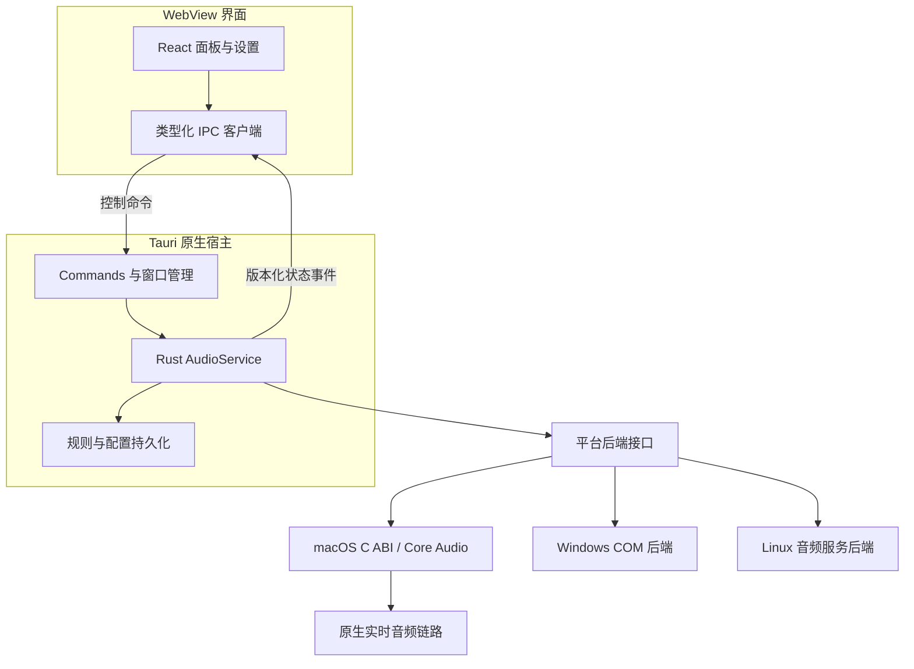
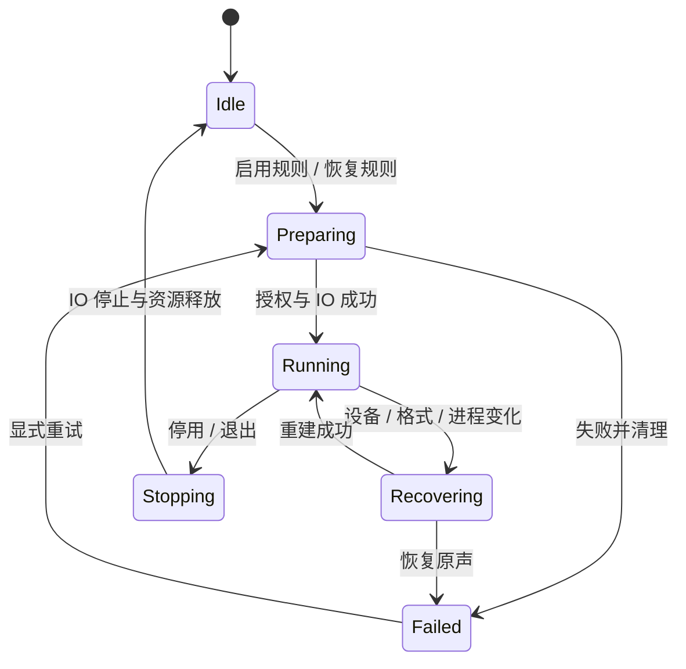

# Mac Voice Mix：Tauri 跨平台技术方案

日期：2026-11-09  
状态：技术设计，尚未创建应用代码或完成真机原型  
产品需求：[产品需求与技术方案](./product-and-technical-plan.md)

## 1. 设计结论与范围

采用 **Tauri 2 + React + TypeScript + Rust + 平台原生音频后端**。界面、配置格式、规则管理、错误模型与大部分业务流程跨平台共享；设备控制、应用音频会话、权限和部分桌面行为分别适配。

首先交付 macOS 的输入设备音量、输出设备音量和应用独立输出音量。Windows、Linux 后续接入统一后端接口。首版建议 macOS 14.4 及以上，优先验证 Apple Silicon；Intel、Windows 及 Linux 的具体支持范围在对应真机验证后确定。

Tauri 官方文档提供 commands、events 和 tray 接口，可支持本方案的控制通信与桌面入口。[T1][T2][T3] 使用这些接口不意味着框架已经提供系统音频混音能力；音频后端仍需要自行开发。

所有架构、时间间隔和性能数字均为拟定设计或验收目标。技术原型未通过前，不承诺任意设备、应用和播放路径都可控制。

## 2. 技术栈与依赖选择

| 层级 | 选择 | 职责与边界 |
| --- | --- | --- |
| 桌面框架 | Tauri 2 | 应用生命周期、托盘、窗口、IPC、打包 |
| 界面 | React + TypeScript | 设备、应用、设置、授权与异常状态展示 |
| 前端构建 | Vite、pnpm | 开发服务、静态资源构建与依赖管理 |
| 样式 | CSS Modules + CSS variables | 紧凑面板、明暗主题、平台布局适配 |
| 前端状态 | React hooks/reducer 起步 | 系统快照、滑块草稿、操作进度；复杂度增加后再引入状态库 |
| 共享业务 | Rust | 音频服务、规则、状态转换、配置、错误映射 |
| 序列化 | serde + serde_json | IPC DTO 与版本化配置 |
| macOS 原生层 | Objective-C++ / C++ + C ABI | Core Audio、进程归属、实时增益与回放 |
| Windows 后端 | Rust + windows crate，版本后续核实 | COM、设备与音频会话接口 |
| Linux 后端 | PipeWire / WirePlumber 候选接口 | 节点、流、默认设备策略与事件，需独立原型 |
| 质量验证 | Vitest、Rust tests、真机音频测试 | 交互、规则、生命周期与真实音频行为 |

Tauri 固定为 2.x；其他依赖在项目初始化时选择兼容的稳定版本，提交前端与 Cargo 锁文件。本文不把未经核实的“最新版本”作为构建条件。

不预先引入数据库、全局状态库或共享 DSP 库。初版配置规模小，JSON 足够；出现实际复杂度或性能需求后再升级。

## 3. 总体架构与运行边界



采用宿主内原生音频库，首版不启动独立音频 sidecar。这样可以减少进程间控制、子进程签名及资源协调复杂度；代价是原生崩溃可能终止宿主，必须验证强制终止时的音频恢复。

Tauri/WebView 的实际进程组成由平台运行时决定，不能假定界面和宿主只有一个进程。音频识别需要排除本产品宿主、可识别的 WebView 辅助进程和自建回放，前端不播放测试声音或业务音频。

音频样本始终留在原生实时链路。Tauri 只传设备信息、音量值、状态和错误。官方说明 events 不适用于低延迟或高吞吐用途，因此不通过 events 传 PCM。[T2]

关闭或重新加载 WebView 不停止混音；Rust 宿主持有服务和生命周期。用户明确退出时，先恢复音频、释放资源，再退出宿主。

## 4. 模块与目录

```text
mac-voice-mix/
  docs/
    product-and-technical-plan.md
    tauri-technical-design.md
  src/
    app/                     # 入口、路由、主题
    features/devices/        # 输入/输出设备
    features/apps/           # 应用音量
    features/settings/       # 设置、规则、诊断
    shared/ipc/              # commands、DTO、事件与错误转换
    shared/components/       # slider、状态说明、设备选择
  src-tauri/
    src/commands/            # 参数校验与服务调用
    src/desktop/             # 托盘、窗口、退出、单实例
    src/lib.rs
    build.rs
    capabilities/
    permissions/
    Info.plist
    tauri.conf.json
    tauri.macos.conf.json
  crates/
    audio-contract/          # 模型、错误、后端接口
    audio-service/           # 状态管理、规则应用与恢复
    audio-macos/             # Rust 安全封装与 FFI
    audio-windows/           # 后续
    audio-linux/             # 后续
    preferences/             # 配置迁移、原子保存
  native/macos/
    include/mvm_audio.h      # C ABI
    src/device_control.mm
    src/process_registry.mm
    src/tap_session.mm
    src/render_engine.mm
  tests/                     # 场景测试和真机记录模板
```

采用 Cargo workspace 管理 Rust 模块。通过平台条件编译选择后端，macOS 框架和原生库只在 macOS 构建时链接。

首版允许合并尚无实际规模的 Rust 模块，避免仅为目录形式制造大量空 crate；接口边界仍按本文维护。

## 5. 共享契约与状态模型

### 5.1 DTO

IPC 使用命名字段和枚举字符串，禁止向前端暴露指针、COM 对象、原始 `AudioObjectID` 或平台可执行命令。

```typescript
type Direction = "input" | "output";
type Platform = "macos" | "windows" | "linux";

interface Capabilities {
  canSetVolume: boolean;
  canMute: boolean;
  canSetDefault: boolean;
  canBoost: boolean;
  unavailableReason?: string;
}

interface DeviceState {
  id: string;                // 稳定设备身份 + direction
  name: string;
  direction: Direction;
  available: boolean;
  isDefault: boolean;
  volume: number | null;      // 系统实际标量；不可读时为 null
  muted: boolean | null;
  capabilities: Capabilities;
}

interface AppState {
  id: string;                // 平台范围内的稳定应用键
  name: string;
  activeSessionCount: number;
  desiredVolume: number;     // 本产品规则，首版 0..1
  desiredMuted: boolean;
  appliedVolume: number | null;
  controlState: "inactive" | "preparing" | "running" | "recovering" | "failed";
  capabilities: Capabilities;
}

interface AudioSnapshot {
  schemaVersion: number;
  serviceInstanceId: string;
  revision: number;
  platform: Platform;
  devices: DeviceState[];
  apps: AppState[];
  capturePermission: "unknown" | "required" | "granted" | "denied" | "unavailable";
}
```

这些是设计示例，最终通过 Rust DTO 生成或一致性检查同步 TypeScript 类型。应用自有音量、设备标量和本产品规则不能混为同一字段。多会话部分成功时 `appliedVolume` 可为空，另提供会话级结果和错误说明。

macOS 设备持久化使用 UID；PID 与音频对象 ID 仅用于运行期映射。应用身份优先使用 bundle identifier，归属不确定时以可辨识的进程身份展示并限制自动持久化匹配。

### 5.2 Rust 服务与后端

`AudioService` 持有状态与规则，平台后端拥有平台对象和执行线程。使用消息投递到后端线程的方式，不要求全部原生对象满足 `Send + Sync`，尤其避免错误跨线程移动 COM 或回调资源。

```text
AudioBackend
  enumerate() -> BackendSnapshot
  set_device_volume(device, scalar) -> ActualDeviceState
  set_device_mute(device, muted) -> ActualDeviceState
  set_default_device(device, direction) -> ActualDefaultState
  set_app_control(app, volume, muted) -> ApplyResult
  enable_app_mixing() -> PermissionAndEngineState
  subscribe_backend_events(sender) -> Subscription
  shutdown_and_restore() -> ShutdownReport
```

接口表示逻辑行为，不要求实现为同步 Rust trait。长操作在后端控制队列执行，Tauri command 异步等待结果；不得阻塞桌面主线程等待授权或音频重建。

每个设备方向和应用规则有独立能力。默认设备选择与输入增益不支持时返回 `Unsupported`，不能通过软件处理本产品的麦克风采样来假装改变其他应用输入。

## 6. Tauri IPC 与一致性

### 6.1 Commands

| Command | 参数 | 返回与用途 |
| --- | --- | --- |
| `get_audio_snapshot` | 无 | 当前完整状态 |
| `set_device_volume` | deviceId、volume、requestId | 回读后的值、revision、requestId |
| `set_device_mute` | deviceId、muted、requestId | 回读状态 |
| `set_default_device` | deviceId、direction、requestId | 系统确认的默认设备 |
| `set_app_control` | appId、volume、muted、requestId | 各会话应用结果；volume/mute 成对更新 |
| `enable_app_mixing` | 用户显式动作 | 开始授权/引擎准备，返回真实结果 |
| `reset_app_rule` | appId | 恢复产品控制层默认值并移除规则 |
| `get_preferences` / `update_preferences` | 限定字段 | 偏好读取与更新 |
| `shutdown_audio` | 无 | 音频恢复报告；通常由 Rust 退出流程直接调用服务 |

Tauri command 通过 `invoke` 调用，支持参数和结果序列化。[T1] command 对标识、数值范围和资源状态再校验，拒绝 NaN、无穷、负值及超过首版上限的值。

滑块本地立即显示草稿，拟定每 30–50 ms 合并发送，松手确保发送最终值。后端对同一目标执行顺序一致，待执行音量可合并，但退出、授权、默认设备切换和静音等动作不能被任意丢弃。

响应携带 requestId；UI 忽略被较新草稿覆盖的旧响应。失败时恢复系统实际值并显示原因。`set_app_control` 将音量与静音作为同一规则提交，减少两个 command 交错造成的错误状态。

### 6.2 状态订阅

首版用 `audio-state-changed` 向已加载的面板和设置页发送小型完整快照，减少前端增量合并复杂度。目标发送频率不超过 10 Hz；设备断连与错误可立即发送。应用数量变大后再按测量结果改用增量更新。

监听注册完成后调用快照 command；注册和获取之间到达的事件先缓冲，再按 `serviceInstanceId + revision` 接受最新状态。宿主实例变化时丢弃旧实例事件，WebView 重载后重新订阅。不能假定 events 提供状态回放或事务顺序。

前端卸载组件时注销监听。窗口隐藏时暂停非必要绘制，音频服务继续运行；显示窗口时重新获取快照。

Tauri events 没有与 commands 相同的细粒度 capabilities 数据控制，发送时选择已知窗口标签并限制载荷。[T2] 音频事件不包含文件系统路径、音频样本或任意调试对象。

## 7. macOS 原生音频后端

### 7.1 桥接选择与构建

推荐 Objective-C++ 封装 Core Audio，导出 C ABI，Rust 的 `audio-macos` 提供安全包装。选择它是为了直接使用 `CATapDescription` 等 Objective-C 对象，并避免首版额外处理 Swift ABI 与运行库部署。

Rust 构建脚本调用 Apple Clang 编译 `.mm` 为静态库，链接实际需要的 CoreAudio、Foundation、AppKit、AudioToolbox 等框架和 C++ 运行库。固定最低系统版本与目标架构，保持原生库、Rust target 和最终 bundle 一致。具体链接集合通过 P0 构建验证后确定。

```c
/* 契约示例，正式实现需补齐 POD 结构与生命周期约定。 */
typedef struct mvm_audio_context mvm_audio_context;
typedef int32_t mvm_status;

mvm_status mvm_audio_create(mvm_audio_context **out_context);
mvm_status mvm_audio_set_device_volume(
    mvm_audio_context *context,
    const char *device_uid,
    uint32_t direction,
    float volume);
mvm_status mvm_audio_set_app_control(
    mvm_audio_context *context,
    uint64_t session_handle,
    float volume,
    uint8_t muted);
mvm_status mvm_audio_shutdown(mvm_audio_context *context);
void mvm_audio_destroy(mvm_audio_context *context);
```

FFI 约定：使用固定宽度整数和 POD；字符串明确 UTF-8、长度与有效期；返回内存由分配侧提供释放函数；句柄只在控制线程使用。C++ 异常与 Rust panic 不穿越边界。原生通知仅在非实时线程发送复制后的元数据。

Rust 安全包装负责有效句柄、回调上下文和销毁顺序；`shutdown` 可重复调用。先注销通知并确认在途回调结束，再释放 Rust callback context，防止悬空访问。

未来如果复杂应用识别更适合 Swift，可在原生库内部加入 Swift 模块，保持对 Rust 的 C 契约稳定，无需改变 React 或共享服务。

### 7.2 设备控制

使用 Core Audio HAL 枚举设备，按输入/输出 scope 检查音量和静音属性及可写性，读写后回读实际状态。优先主音量，无主音量时评估声道策略并保留左右平衡；不能只控制第一个声道后宣称控制整个设备。

监听默认设备、设备列表、音量、静音和格式变化。系统监听回调投递至后端控制线程，重新检查对象有效性。0% 与静音的联动在每类设备上验证，不能保证所有硬件都提供相同控制。

首版不包含 DDC/CI 硬件调音。缺少可写音量时显示能力限制，不拦截所有系统音频来模拟“硬件音量”。

### 7.3 应用混音与实时线程

Apple 描述的 process tap 支持指定进程音频捕获、抑制原始播放，并通过 aggregate device 使用 tap。[A1] 具体回放拓扑由原型验证后锁定。

首批原型先使用单应用、48 kHz 双声道与内置/有线输出。推荐尝试每应用独立受控链路，每条链路将指定进程组的 tap 接入私有 aggregate device，并在相应 IO 回调完成增益与回放；确认 HAL 回调缓冲映射及物理输出同步后再扩展多应用。

如果输入和输出不能在同一同步回调中可靠处理，采用预分配环形缓冲和独立输出回调；必须测量时钟漂移、缓冲欠载和额外延迟。该备选拓扑不能在未验证时宣称无缝切换。

控制队列负责建图、权限、格式、资源和应用归属。实时回调只读原子目标参数、执行平滑增益、处理预分配缓冲、更新轻量计数器。禁止在回调调用 Tauri、执行 JSON 序列化、日志格式化、文件 IO、阻塞锁或不可控内存分配。

应用规则首版线性范围 0..1：`sample_out = sample_in × gain`。增益变化拟定在 5–20 ms 内渐变，静音目标为零；具体时间以听感和测试确认。100% 表示本产品不衰减，不代表改变第三方应用内部音量。

只对需要自定义音量/静音的应用建立链路。默认 100% 且未静音的应用继续系统路径。启停顺序必须避免原声和处理后声音叠加，以及长期只抑制原声却没有回放。

输出切换初版只自动迁移确实跟随默认输出的受控流。应用自选输出设备先识别并保留；无法可靠处理时停止接管并报告限制，不擅自把第三方应用路由到默认设备。

### 7.4 授权与生命周期

`NSAudioCaptureUsageDescription` 说明本地实时调整应用音量用途；Apple 示例说明首次从包含 tap 的 aggregate device 开始录制时触发系统音频授权。[A1] Tauri 可合并自定义 Info.plist，并提供平台配置覆盖。[T5][T6]

权限状态从实际音频操作结果推断和维护；未知时不虚构为已授权。授权按钮开始真实的引擎准备，失败或拒绝时清理资源。系统设置入口由后端打开固定目标，具体 deep link 在目标 macOS 实测，失效时提供文字导航。

开发及发布验证都使用稳定 bundle identifier，检查最终 `.app` 的 plist、签名和运行身份。不能仅用裸命令行二进制测试成功就判断 Tauri bundle 的 TCC 行为正常。



会话有 generation 标记，重建后的回调忽略旧 generation。恢复期间的新请求更新目标规则，不在旧资源上执行。

正常退出先解除接管、恢复原始播放，再停止 IO、销毁 tap/aggregate 与注销监听；实际可靠顺序依据 mute 模式原型确认。强制终止无法依赖退出回调，必须测试系统资源清理。若无法稳定恢复，再评估 helper/watchdog 等额外机制。

## 8. Windows 与 Linux 扩展

| 平台 | 实现规划 | 限制与验证 |
| --- | --- | --- |
| Windows | 专用 COM 线程；枚举 endpoint、音量接口、会话；按应用聚合 | 会话控制只面向适用的共享模式；独占模式不能由会话音量保证控制 [W1] |
| Linux | 优先 PipeWire + WirePlumber；原生库或受控音频服务接口 | stream/node 音量、默认设备策略、应用身份和事件接口需原型核实 [L1][L2] |

Windows 使用 `IMMDeviceEnumerator`、`IAudioEndpointVolume`、`IAudioSessionManager2` 和 `ISimpleAudioVolume` 作为实现入口。设备默认角色区分通用播放与通信；默认设备修改不依赖未经批准的私有 PolicyConfig 实现，若公开可行方案未确定，先提供系统设置入口及禁用说明。

一个应用可以包含多个会话，所有受支持会话应应用同一规则并报告部分失败。Windows 已有系统会话音量：启动时优先读取系统状态，没有产品规则时不重置为 100%。有规则时按明确的恢复策略写入，新会话再应用规则。退出后默认保留用户已设置的系统会话音量，与 macOS 移除临时 DSP 接管的行为分别定义。

Linux 默认修改会话管理器实际控制值。优先验证 native API；`wpctl` 等工具只作为原型/诊断候选，不把频繁启动 CLI 和解析显示文本作为正式高频后端。Node ID 只作运行期标识，持久化身份结合应用元数据和明确匹配规则。

首个 Linux 版本限定经过测试的 PipeWire + WirePlumber 环境，发行版、桌面环境和 Flatpak 等沙盒分发单独定义矩阵。后端运行在对应音频服务事件线程，不强行套用 macOS 捕获回放链路。

三个平台共用功能界面，但“应用音量”的机制、退出恢复与最大范围通过平台状态和能力明确表达。

## 9. 桌面入口、窗口与退出

托盘由 Rust 持有，启用 Tauri `tray-icon` 特性。[T3] 面板默认隐藏，点击入口显示 React 混音面板；设置页使用独立窗口。托盘菜单始终包含“打开面板”“设置”“退出”，窗口关闭表示隐藏。

macOS 验证菜单栏锚定、多显示器、缩放、Space、全屏、焦点和失焦隐藏。Tauri 窗口是否满足弹出面板行为先做原型；如需原生 NSPanel 或额外插件，封装在 `desktop/macos`，核实公开接口与分发影响后再选择。

Linux 托盘点击恢复窗口存在后端限制，Tauri 维护者说明过相关 libappindicator 限制。[T7] 因此“打开面板”菜单和普通窗口入口必须可用，不把悬浮面板与直接点击当全平台唯一入口。

macOS 拟使用 accessory activation policy，避免常驻 Dock；打开设置、退出和系统授权焦点行为需验证。Windows/Linux 使用对应平台窗口行为。单实例处理从宿主初始化阶段生效，防止两个实例同时接管同一应用。

退出进入 `shutting_down`，拒绝新增音频变更并等待后端恢复报告。失败时向用户提供具体受影响应用和重试入口；不使用未完成清理的即时 `exit` 替代正常流程。确认恢复成功后才终止宿主。

## 10. 配置、错误与诊断

Rust 在平台标准配置目录保存 JSON：`schemaVersion`、应用规则、偏好、更新时间。分离系统实际状态与保存目标，默认不持久化后自动覆盖设备音量或强制选择默认设备。

规则成功应用后合并写盘，拟定 300–500 ms 防抖，正常退出刷新。写入同目录临时文件、替换并保留必要恢复副本；各平台替换语义需验证。配置迁移按版本递增，损坏时备份并使用默认配置启动。

```text
AudioError
  code: Unsupported | PermissionDenied | DeviceUnavailable
        | SessionUnavailable | BackendFailure | Busy | InvalidArgument
  targetId: optional
  operation: string
  retryable: boolean
  platformCode: optional
  messageKey: string
```

UI 使用可理解的中文说明，平台错误码用于诊断。对第三方应用归属不确定、部分会话失败和资源重建失败分别报告。

日志采用有界保留与文件轮换，只记录元数据、操作及错误。实时回调只累加欠载、重建、峰值等计数，由非实时线程读取。诊断导出需用户主动操作，默认不包含音频、完整文件路径或用户敏感标识。

## 11. Tauri 权限配置

窗口加载本地构建资源，外部链接由后端处理固定允许目标。配置 CSP 与各窗口最小 capabilities，前端不直接获得任意文件写入、shell 或动态执行能力。

Tauri capabilities 限制窗口可调用的功能，但官方说明应用通过 `invoke_handler` 注册的 commands 默认对应用窗口可用；需要使用 app command manifest 等机制纳入显式权限。[T4] 实现时为音频/偏好 commands 定义权限，只授权 `mixer`、`settings` 等已知窗口，并测试未授权窗口被拒绝。

不要认为在 capabilities 目录写一个文件就自动保护全部自定义 command。Tauri 权限与 macOS TCC 分别处理；前者控制 WebView 对宿主的访问，后者控制系统音频捕获。

## 12. 构建、发布与验证

macOS 在 Apple 工具链上构建原生库、Rust 和 `.app`；首版 DMG 分发，发布前签名、公证并真机验证安装后的权限及启动。目标系统与架构分别构建；Intel 支持或 universal bundle 在原生依赖一致性测试后启用。

Windows 后续使用相应 Windows 工具链构建并选择安装器；Linux 根据目标发行版确认 WebView、音频库、托盘与打包依赖。共享源码不等于在一台机器上无条件产出所有平台安装包。

初始化后预计提供以下项目命令，具体脚本在实现时定义：

```text
pnpm dev           # 前端浏览器预览，用 mock 数据，不能控制真实音频
pnpm tauri dev     # 完整桌面开发
pnpm typecheck
pnpm test
pnpm build
cargo fmt --check
cargo clippy --workspace --all-targets
cargo test --workspace
pnpm tauri build   # 当前平台安装包
```

验证分为三类：

- 前端：滑块最终值、旧响应处理、订阅重载、权限拒绝、能力禁用和键盘操作。
- Rust/桥接：规则恢复、会话聚合、配置迁移、命令序列、FFI ownership、监听取消与退出幂等。
- 真机：真实设备增益、两应用独立音量、重复回放、延迟、蓝牙断连、系统权限、睡眠唤醒、强制终止与安装包行为。

内置/有线输出的额外延迟目标不超过 30 ms，3 应用基础链路 CPU 平均目标小于 5%；均需标注芯片、系统、采样率和统计口径。Tauri/WebView 的空闲内存与 CPU 另行测量，不沿用原生 SwiftUI 的资源假设。1 小时播放无可听断音和持续内存增长后，再扩大压力测试。

## 13. 实施顺序与阶段门槛

| 阶段 | 工作与交付物 | 进入下一阶段的条件 |
| --- | --- | --- |
| P0-A：桌面与桥接 | Tauri 最小壳、托盘、React 面板、C ABI、设备枚举/音量 | 最终 bundle 内运行，设备回读与窗口行为通过 |
| P0-B：音频原型 | 单应用 tap/增益/回放、授权、正常退出与强制终止记录 | 独立音量成立，无重音，失败可恢复原声 |
| P0-C：多应用与恢复 | 多进程归属、多链路、格式变化、设备断连、睡眠 | 浏览器/播放器/会议应用场景与恢复通过 |
| P1：macOS 首版 | 完整三类音量 UI、规则、错误、诊断、DMG | 产品文档核心验收通过 |
| P2：体验扩展 | 场景预设、快捷键、开机启动；增益与显示器支持评估 | 各功能按目标系统验证 |
| P3/P4：跨平台 | Windows 后端，随后 Linux 后端及支持矩阵 | 复用 UI 和规则契约，平台限制展示准确 |

先验证 Tauri bundle 的权限与音频恢复，再投入完整产品界面。若 process tap 链路无法达到原声恢复和兼容性门槛，应重新设计或评估专用音频 helper/驱动路线，明确安装和维护成本后再决定。

## 14. 本方案尚未解决的验证问题

- 私有 aggregate device 的具体回放拓扑、不同物理设备时钟与声道映射。
- process tap 静音模式在权限撤销、IO 失败、崩溃和强制终止后的恢复行为。
- Tauri 宿主及 WebView 辅助进程的音频身份排除，浏览器和会议软件的辅助进程归属。
- 菜单栏定位、NSPanel 是否必要、macOS 14.4 与更新系统的授权差异。
- Windows 默认设备设置的可靠公开路径；Linux 音量、默认策略与事件的正式接口。
- 实际空闲资源消耗、多应用延迟，以及 Intel 和各 Linux 桌面环境的支持范围。

上述问题都对应 P0 或后续平台原型，不以参考项目能够运行作为本项目已验证的依据。

## 15. 官方参考资料

以下资料用于核对接口能力，具体 SDK、依赖版本和系统行为在实现时再次确认。Linux 文档为后续原型入口，本文尚未完成 Linux API 级验证。

- **T1**：Tauri，Calling Rust from the Frontend：`https://v2.tauri.app/develop/calling-rust/`。
- **T2**：Tauri，Calling the Frontend from Rust：`https://v2.tauri.app/develop/calling-frontend/`。
- **T3**：Tauri，System Tray：`https://v2.tauri.app/learn/system-tray/`。
- **T4**：Tauri，Capabilities：`https://v2.tauri.app/security/capabilities/`；Permissions：`https://v2.tauri.app/security/permissions/`。
- **T5**：Tauri，macOS Application Bundle：`https://v2.tauri.app/distribute/macos-application-bundle/`。
- **T6**：Tauri，Configuration：`https://v2.tauri.app/reference/config/`。
- **T7**：Tauri 官方维护者讨论，Linux tray click limitation：`https://github.com/orgs/tauri-apps/discussions/15459`。
- **A1**：Apple，Capturing system audio with Core Audio taps：`https://developer.apple.com/documentation/coreaudio/capturing-system-audio-with-core-audio-taps`。
- **W1**：Microsoft，Exclusive-Mode Streams：`https://learn.microsoft.com/en-us/windows/win32/coreaudio/exclusive-mode-streams`。
- **L1**：PipeWire 官方文档：`https://docs.pipewire.org/`。
- **L2**：WirePlumber 官方文档：`https://pipewire.pages.freedesktop.org/wireplumber/`。
